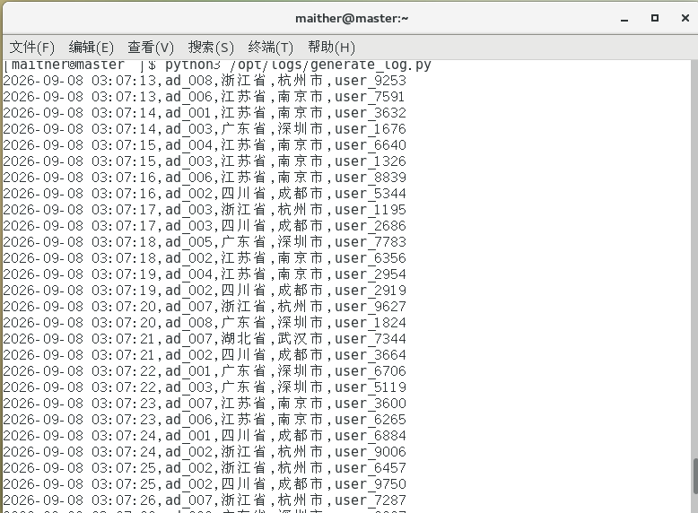
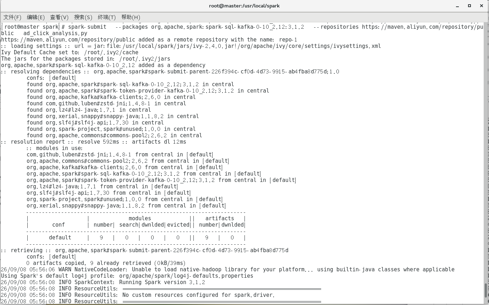
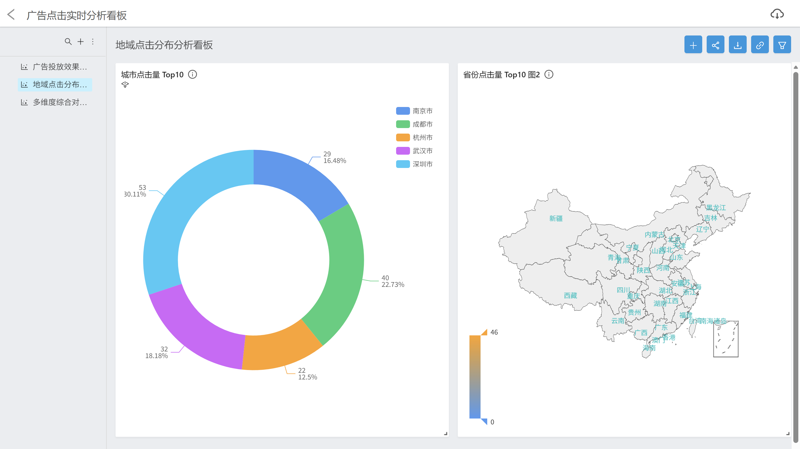

# 📊 广告点击实时分析系统

> 基于 **PySpark Structured Streaming + Kafka + MySQL** 的广告点击流式实时分析，按广告位 / 省份 / 城市三个维度实时统计点击量，并通过可视化看板展示。

## 项目简介

广告点击日志经 Kafka 消息队列进入 Spark Structured Streaming，以 10 秒微批窗口聚合点击量，批量 Upsert 写入 MySQL 统计表，最终通过可视化看板呈现地域点击分布与多维度对比。

## 技术栈

| 组件 | 说明 |
|---|---|
| PySpark 3.1.2 | Structured Streaming 流式计算（spark-sql-kafka 连接器） |
| Kafka | 消息队列，topic: `ad_click` |
| MySQL 8.0 | 统计结果落库（Upsert 累加计数） |
| Davinci | 可视化看板（城市 Top10 环形图、省份热力图等） |
| Linux | 单机部署环境（master 节点） |

## 系统架构


## 快速启动

```bash
# 1. 初始化数据库（3 张统计表）
mysql -u root -p < sql/create_tables.sql

# 2. 启动 Kafka（单机）
zookeeper-server-start.sh config/zookeeper.properties &
kafka-server-start.sh config/server.properties &

# 3. 模拟产生点击日志（终端运行 generate_log.py 即可看到日志滚动输出，默认写入 /opt/logs/ad_click.log，可按环境修改）
python3 generate_log.py

# 4. 提交 Spark 流任务
spark-submit --packages org.apache.spark:spark-sql-kafka-0-10_2.12:3.1.2 \
  --repositories https://maven.aliyun.com/repository/public \
  ad_click_analysis.py
```

> 脚本内置 MySQL/Kafka 连接配置，按实际环境修改脚本顶部配置常量即可。

## 功能说明

- **三维度实时统计**：广告位（ad_id）、省份、城市各自独立的分组聚合与累计计数
- **微批窗口**：`trigger(processingTime="10 seconds")`，10 秒一个微批
- **批量 Upsert 落库**：`foreachBatch + foreachPartition` 批量执行 `INSERT ... ON DUPLICATE KEY UPDATE click_count = click_count + N`，存在累加、不存在插入，保证多次运行计数正确
- **可视化看板**：城市点击量 Top10 环形图、省份点击量 Top10 中国地图热力图（示例截图见下）

## 界面截图

| 日志模拟生成 | Spark 任务提交 | 可视化看板 |
|---|---|---|
|  |  |  |

## 演示视频

[demo/demo.mp4](demo/demo.mp4) — 完整运行演示（含数据产生、任务提交、看板展示）。

## 项目难点与解决（3 个）

### 1️⃣ 流式结果写 MySQL 的性能瓶颈
Streaming 每个微批都会产出一批统计结果，若逐行 `INSERT` 写库，数据量大时延迟高、连接开销大。

**解决**：采用 `foreachBatch` 配合 `foreachPartition`，在每个分区内**批量收集数据后一次性执行多条 Upsert**（复用单连接、批量执行），显著降低写入次数；空分区直接跳过，避免无意义连接。

### 2️⃣ 多次运行 / 重复消费的计数正确性
流任务重启或重复消费同一批数据时，如果直接覆盖写入，累计点击量会被重置或漏算。

**解决**：使用 `INSERT ... ON DUPLICATE KEY UPDATE click_count = click_count + %s` 的 **Upsert 累加语义**——记录不存在则插入，已存在则在原值上累加，保证"同一广告位/省份/城市的点击量只增不减"，重启后计数连续正确。

### 3️⃣ 脚本可维护性与运行噪音
早期版本配置散落在代码各处、异常只打印堆栈、成功日志刷屏，排障困难。

**解决**：迭代重构（1.0 → 1.2）：**配置常量统一管理**（Kafka/MySQL/窗口间隔集中定义）、**成功日志开关化**（默认只输出错误）、**异常分级打印**（错误类型 + 详情 + 堆栈定位），大幅提升健壮性与可维护性。

## 目录结构

```
ad-click-analysis/
├── generate_log.py              # 模拟广告点击日志生成脚本
├── ad_click_analysis.py         # Spark Structured Streaming 实时统计主脚本
├── sql/create_tables.sql       # MySQL 建表脚本（3 张统计表）
├── docs/screenshots/           # 运行截图（日志生成 / 任务提交 / 看板）
└── demo/demo.mp4               # 演示视频
```

## 许可证

本项目仅用于课程设计与学习用途。
